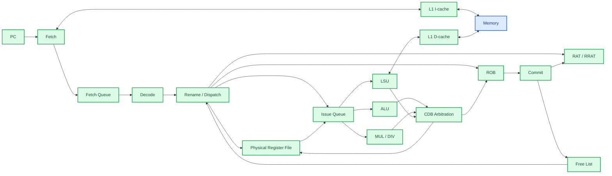

# RV32IM Research Core

[English](#english) | [中文](#中文)

## English

### Overview

RV32IM Research Core is a SystemVerilog processor project for bare-metal execution and microarchitecture experiments. It includes a multicycle reference core, a five-stage in-order pipeline, and a single-dispatch/single-issue out-of-order (OoO) core, with a common architectural commit interface for differential verification.

The current baseline integrates register renaming, dynamic issue, out-of-order completion, in-order retirement, recovery, RV32M arithmetic, and separate L1 instruction/data caches. Loads and stores issue only at the reorder-buffer (ROB) head; more aggressive memory scheduling is future work.

| Implementation | Role |
|---|---|
| `rv32_reference_core` | Multicycle in-order reference |
| `rv32_pipeline_core` | Five-stage in-order implementation |
| `rv32_ooo_core` | Single-dispatch/single-issue OoO implementation |
| `rv32_pipeline_l1_top` / `rv32_ooo_l1_top` | Pipeline/OoO integration with split L1 caches |

The OoO configuration has a 16-entry ROB, 64 physical registers, an eight-entry issue queue, and an eight-entry fetch queue. Each L1 is a parameterized 32 KiB direct-mapped blocking cache with 32-byte lines; the D-cache uses write-back and write-allocate.

See [FEATURES.md](FEATURES.md#english) for the complete component inventory, verification coverage, and focused test commands.

### Architecture



Green nodes are integrated components; blue is the external memory environment. Arithmetic operations can execute out of order, while memory issue and architectural retirement remain ordered.

### Measured baseline

| Measurement | Result |
|---|---|
| External correctness | Six RV32IM workloads passed offline Spike comparison; 3,652,225 retirement events compared |
| Workload IPC | 0.208373–0.296710 in the measured regions of interest |
| Core-only timing | 200 MHz target met; worst setup slack +0.5010 ns |
| Mapped core area | 98,060.368 µm², 50,304 standard cells |

IPC is instructions per cycle, measured with split L1 caches and the documented simulation-memory configuration. The timing result uses Nangate45 typical, estimated post-placement parasitics, and an ideal clock; it excludes L1 caches and is pre-clock-tree/pre-route. The tested clock target is not an identified maximum frequency or a final system frequency. The area is mapped cell area, not die area.

[Workload results](docs/results/ooo-l1-baseline.md) · [Timing constraints and critical path](docs/results/ooo-core-timing.md) · [Spike comparison scope](docs/verification/rv32-spike-verification.md)

### Quick start

The simulation flow uses Icarus Verilog. Python 3 and a RISC-V bare-metal GCC/binutils toolchain are needed for software images; Spike is needed for independent ISA comparison. Verilator is an alternative benchmark engine. Core synthesis/timing requires Yosys with the slang frontend, OpenROAD, and the Nangate45 platform files.

With tools on PATH:

```bash
# Directed unit, integration, and internal commit-differential regressions
make BUILD_DIR=/tmp/rv32-test test

# Independent Spike comparison on a repository-owned C test
make BUILD_DIR=/tmp/rv32-spike test-spike PROGRAM=sw/tests/smoke.c SPIKE=/path/to/spike

# Reproduce the core-only timing target
make BUILD_DIR=/tmp/rv32-sta sta-ooo NANGATE45_DIR=/path/to/Nangate45 OOO_PERIOD=5
```

Supply `CAD_ENV=/path/to/env.sh` when a simulation/CAD tool environment needs initialization. The [feature inventory](FEATURES.md#english) lists focused tests and the six-workload batch command. External workload binaries are local inputs and are not redistributed; their measurement conditions are recorded in the results report.

### Scope and next directions

This is an RV32IM little-endian bare-metal baseline, not a privileged operating-system platform. Synchronous exceptions are reported precisely and halt the core; no privileged trap handler, virtual memory, Linux, or multicore coherence is implemented. FENCE.I and the A/F/D/C/V extensions are not supported.

Unified L2, a load/store queue with early loads and store-to-load forwarding, advanced branch prediction, superscalar issue, full ISA compliance certification, and physical signoff remain outside this version. These are extension directions, not claims about the measured baseline.

### Repository and documentation

```text
rtl/         Processor RTL, shared types, and L1 caches
tb/          Unit/integration testbenches and simulation memory models
sw/          Bare-metal startup, linker script, and test programs
scripts/     ELF conversion, Spike comparison, synthesis, and timing tools
docs/        Design notes, verification references, and measured results
FEATURES.md  Detailed component inventory and test commands
```

[Documentation index](docs/README.md) · [Pipeline design](docs/design/rv32-pipeline-core.md) · [OoO design](docs/design/rv32-ooo-core.md)

### License

[Apache License 2.0](LICENSE). External test inputs are not included in the project distribution.

---

## 中文

### 项目简介

RV32IM Research Core 是一个面向裸机程序和微架构实验的 SystemVerilog 处理器项目，包含多周期顺序参考核、五级顺序流水线和单分派、单发射的乱序执行核心。三个实现使用公共的架构提交接口，便于按指令退休顺序进行差分验证。

当前基线已经集成寄存器重命名、动态发射、乱序完成、顺序退休、恢复机制、RV32M 乘除法以及分离式 L1 指令和数据 cache。Load/Store 仅在重排序缓冲区（ROB）队首发射，更激进的访存调度留作后续扩展。

| 实现 | 用途 |
|---|---|
| `rv32_reference_core` | 多周期顺序参考核 |
| `rv32_pipeline_core` | 五级顺序流水线 |
| `rv32_ooo_core` | 单分派、单发射的乱序执行核心 |
| `rv32_pipeline_l1_top` / `rv32_ooo_l1_top` | 流水线／OoO 与分离式 L1 的集成顶层 |

当前 OoO 配置使用 16 项 ROB、64 个物理寄存器、8 项发射队列和 8 项取指队列。两个 L1 均为参数化的 32 KiB 直接映射、阻塞式 cache，cache line 为 32 字节；D-cache 使用写回和写分配策略。

完整组件说明、验证覆盖和分项测试命令见 [FEATURES.md](FEATURES.md#中文)。

### 架构


绿色表示已集成的组件，蓝色表示外部存储器环境。算术操作可以乱序执行，访存发射和架构状态的退休仍保持顺序。

### 实测基线

| 测量项目 | 结果 |
|---|---|
| 外部正确性 | 六个 RV32IM 工作负载通过离线 Spike 差分，累计比较 3,652,225 条退休指令 |
| 工作负载 IPC | 实际测量区间内为 0.208373–0.296710 |
| 仅核心时序 | 200 MHz 目标通过，最差 setup slack 为 +0.5010 ns |
| 核心映射面积 | 98,060.368 µm²，50,304 个标准单元 |

IPC 表示每周期退休的指令数，来自包含分离式 L1 的仿真，存储器配置见结果报告。时序使用 Nangate45 typical、布局后估算寄生参数和理想时钟，排除两个 L1，尚未进行时钟树和布线。200 MHz 是已经验证的目标，不是测得的最高频率，也不是最终系统频率。面积为映射后的单元面积，不是芯片面积。

[工作负载结果](docs/results/ooo-l1-baseline.md) · [时序约束与关键路径](docs/results/ooo-core-timing.md) · [Spike 检查范围](docs/verification/rv32-spike-verification.md)

### 快速运行

仿真使用 Icarus Verilog。软件镜像需要 Python 3 与 RISC-V 裸机 GCC/binutils 工具链，独立 ISA 差分需要 Spike；benchmark 可选择 Verilator。核心综合与时序需要带 slang 前端的 Yosys、OpenROAD 和 Nangate45 平台文件。

工具已在 PATH 时：

```bash
# 单元、集成及内部提交差分回归
make BUILD_DIR=/tmp/rv32-test test

# 使用仓库自有的 C 测试程序进行 Spike 差分
make BUILD_DIR=/tmp/rv32-spike test-spike PROGRAM=sw/tests/smoke.c SPIKE=/path/to/spike

# 复现仅核心的时序目标
make BUILD_DIR=/tmp/rv32-sta sta-ooo NANGATE45_DIR=/path/to/Nangate45 OOO_PERIOD=5
```

仿真／CAD 工具需要初始化时可传入 `CAD_ENV=/path/to/env.sh`。[功能清单](FEATURES.md#中文)包含分项测试和六程序批量测试命令。外部工作负载二进制作为本机输入，不随项目分发；测量条件保存在结果报告中。

### 范围与后续方向

当前版本是小端、裸机 RV32IM 基线，不是特权级操作系统平台。同步异常精确提交后使核心停止运行，未实现特权级 trap handler、虚拟内存、Linux 或多核一致性；不支持 FENCE.I 和 A/F/D/C/V 扩展。

Unified L2、支持提前 Load 与 Store-to-Load forwarding 的访存队列、复杂分支预测、超标量发射、完整 ISA 合规认证及物理签核均不属于当前版本。这些是后续扩展方向，不是现有实测基线已经具备的能力。

### 仓库与文档

```text
rtl/         处理器 RTL、公共类型和 L1 cache
tb/          单元／集成 testbench 与仿真存储器模型
sw/          裸机启动代码、链接脚本和测试程序
scripts/     ELF 转换、Spike 差分、综合与时序工具
docs/        架构说明、验证资料和实测结果
FEATURES.md  详细功能清单与测试命令
```

[文档索引](docs/README.md) · [流水线设计](docs/design/rv32-pipeline-core.md) · [OoO 设计](docs/design/rv32-ooo-core.md)

### 开源许可证

[Apache License 2.0](LICENSE)。外部测试输入不包含在项目分发内容中。
